# 基于 STM32 与 Flask 的智能叫号系统软件实现说明书

**文档版本：** V2.0（当前实现核对版）  
**修订日期：** 2026-11-16  
**硬件平台：** STM32F103RCT6、ESP8266、ST7735、4×4 矩阵键盘、JR6001、TDA7266  
**服务端平台：** Python Flask + SQLite + 患者/调试网页  
**硬件依据：** `原理图/Sheet_1_2026-11-16.schdoc`、`原理图/Sheet_1_2026-11-11.net`、当前实物  
**固件依据：** 当前 Keil 工程及 2026-11-16 00:44:43 Rebuild 产物  
**实测环境：** 诊室 `01`，Flask 服务 `192.168.123.151:5000`，终端实测地址 `192.168.123.141`

> 说明：原始文件名中的“双热备服务器架构”是早期规划名称。当前实物和代码实现的是**单 Flask 服务节点 + STM32 本地离线操作保底**。本文不将双机热备、微信小程序、Flash 掉电恢复等尚未完成的功能写成既有成果。

## 1 文档目的与实现范围

### 1.1 编写目的

本文面向毕业论文撰写、系统复现、硬件联调和后期维护，按“硬件连接—驱动—应用—通信—服务端—实测”的顺序说明系统实现。阅读本文应能够完成以下工作：

1. 理解医生终端、患者网页和 Flask 服务端之间的数据流。
2. 按当前引脚表连接 STM32 与各外设，并理解每个软件模块的职责。
3. 编译、烧录和启动系统，复现取号、同步、叫号和调试日志。
4. 根据 J-Link、UART 环形缓冲和网页日志定位同步故障。
5. 将系统架构图、状态机、接口表和实测结果整理为毕业论文章节。

### 1.2 当前已实现功能

| 子系统 | 当前实现 | 实现位置 |
|---|---|---|
| 医生终端 | 下一位、重呼、过号、回呼过号、暂停/继续 | `app_key.c`、`app_queue.c` |
| 本地队列 | A001～A012 预置、100 条容量、去重追加、满队列清理 DONE | `app_queue.c` |
| 键盘 | 4×4 扫描、20 ms 扫描周期、连续两次稳定识别、FPC 反插映射 | `keypad.c` |
| TFT | 诊室、WiFi、当前号、服务端等候/过号、暂停与确认提示 | `ui_main.c` |
| 声音 | TIM3 PWM 提示音、JR6001 分段语音播报 | `buzzer.c`、`jr6001.c` |
| WiFi | AT 初始化、SSID 扫描、自动连接、断线重连、UART 中断接收 | `esp8266.c` |
| HTTP | 非阻塞五态状态机、叫号上报、新号拉取、状态拉取、心跳、异常关闭 | `http_client.c` |
| 调试 | 每次按键生成 JSON 快照，独立 16 条环形队列，网页展示并写日志 | `http_client.c`、`debug.html`、`app.py` |
| 服务端 | 取号、个人进度、诊室状态、叫号、心跳、pending、历史和调试 API | `server/app.py` |
| 数据存储 | `room_state`、`tickets`、`history` 三张 SQLite 表 | `server/app.py` |
| 患者网页 | 取号、本地保存号码、2 s 自动刷新、当前号和等候状态显示 | `server/static/index.html` |

### 1.3 尚未实现或不应写成已实现的内容

| 项目 | 当前状态 | 论文中的建议表述 |
|---|---|---|
| 树莓派主服务 + PC 备用服务双热备 | 未实现，目前仅电脑运行单 Flask 服务 | 作为后续可靠性扩展 |
| 3 s 主备自动切换 | 未实现 | 不作为测试结论 |
| 微信小程序 | 未实现，当前为通用浏览器网页 | 可复用现有 HTTP API 开发 |
| Flash 掉电保存和恢复队列 | 未实现，队列为 RAM 数据 | 复位后重新载入 A001～A012 |
| 离线操作完整批量补传 | 未实现 | 离线保留本地操作；恢复后同步最新状态和后续新号 |
| 生产级部署、HTTPS、用户认证 | 未实现 | 当前用于局域网教学与毕业设计验证 |
| 服务端重启后的业务数据保留 | 未实现 | `init_db()` 当前会清空三张表并重建初始诊室 |

## 2 系统总体设计

### 2.1 设计目标

系统针对小型诊室排队场景，将“患者取号”“医生叫号”“状态展示”和“故障定位”连接成闭环。设计重点不是单纯实现号码递增，而是解决以下工程问题：

- 医生终端在服务器暂时不可用时仍能操作本地队列。
- 网页新取号码能够越过终端预置的 12 条演示号码持续进入队列。
- 当前号、等候人数和过号人数有明确的数据来源，避免多端各算一套。
- WiFi 已连接不等于 HTTP 事务正常，必须分别观察无线状态和 TCP 状态。
- 网络收发不能阻塞键盘、显示和语音任务。
- 每次按键都能留下可分析的状态证据，而不是只凭界面现象判断。

### 2.2 网络拓扑与数据流

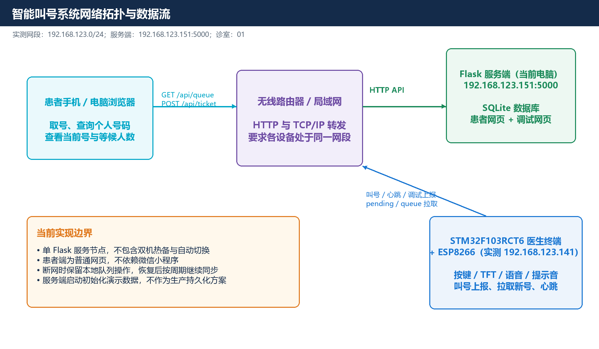

*图 2-1 系统网络拓扑与当前实现边界*

系统使用局域网 HTTP 通信。患者浏览器通过 `/api/ticket` 取号，通过 `/api/queue` 和 `/api/ticket` 查询进度；STM32 终端通过 ESP8266 建立短 TCP 连接，发送 HTTP 请求。Flask 将业务状态写入 SQLite，并同时提供患者网页和调试网页。

当前实测服务端地址为 `192.168.123.151:5000`，诊室编号为 `01`。调试日志显示终端来源地址为 `192.168.123.141`。更换路由器或电脑后，应同时检查终端 `HTTP_SERVER_HOST`、电脑防火墙和实际网段。

### 2.3 一次完整业务流程

1. 患者打开网页并点击“我要取号”。服务端生成新的序号，写入 `tickets`，返回号码和预计前方人数。
2. 终端以本地最大序号为游标请求 `/api/device/pending`，取得该序号之后的等候号码。
3. 终端解析逗号分隔的号码，`QUEUE_Append()` 去重后追加为 `TICKET_WAIT`。
4. 医生按“1”执行下一位。当前号转为 DONE，最早等候号转为 CALLING，队列版本号增加。
5. HTTP 调度器优先上报 `/api/device/call`。服务端更新 `room_state.current_ticket`，并把序号不大于当前号的等候记录置为 `done`。
6. 服务端每次查询实时统计 `tickets.status='waiting'` 的数量，患者网页约 2 s 刷新一次。
7. 按键动作另外生成调试快照，业务空闲时 POST 到 `/api/device/debug`，供 `/debug` 页面和 `debug.log` 分析。

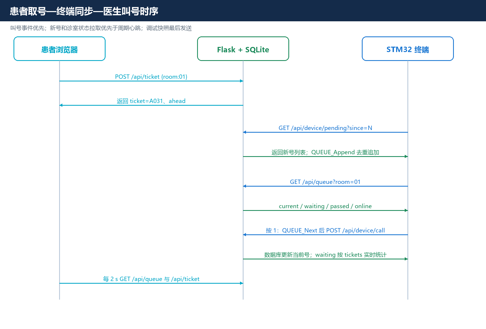

*图 2-2 患者取号—终端同步—医生叫号时序*

## 3 硬件组成与接口实现

### 3.1 硬件组成

| 模块 | 型号/参数 | 在系统中的作用 |
|---|---|---|
| 主控 | STM32F103RCT6，LQFP64 | 队列、按键、显示、语音、WiFi 和 HTTP 调度 |
| 存储资源 | 256 KB Flash、48 KB RAM | 当前构建远小于芯片容量，可继续扩展 |
| 无线模块 | ESP8266 / NodeMCU | 通过 USART2 执行 AT 指令和 TCP HTTP 通信 |
| 显示器 | 1.8 寸 ST7735，128×160 | 医生终端状态显示，GPIO 软件 SPI |
| 输入设备 | 4×4 矩阵键盘 | 叫号、过号、回呼和暂停操作 |
| 语音模块 | JR6001 | 按 WAV 片段组合播报号码和诊室 |
| 音频功放 | TDA7266 模块 | 将 TIM3 PWM 提示音放大输出 |
| 独立按键 | KEY0、KEY1、WK_UP | 原理图预留，当前核心流程以矩阵键盘为主 |
| 状态指示 | LED0、LED1 及电源指示 | 硬件状态和扩展指示 |
| 时钟 | 8 MHz HSE、32.768 kHz LSE | 主时钟与低速外设时钟 |
| 调试接口 | J-Link SWD | 下载、RAM 读取、变量观察和事件注入 |

### 3.2 最新原理图

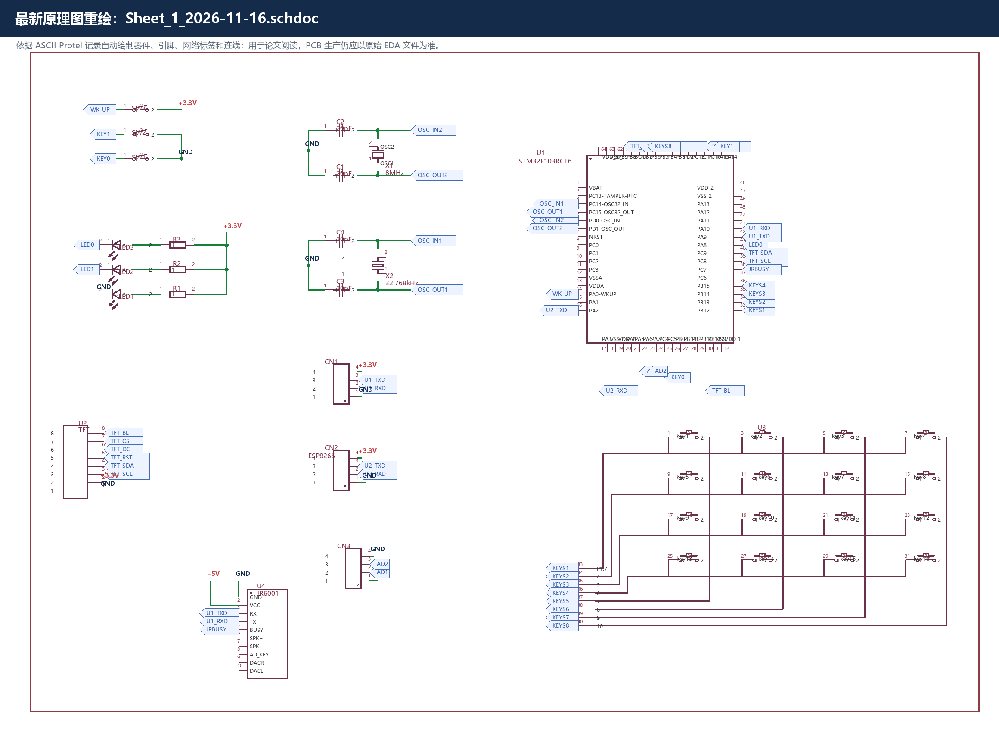

*图 3-1 依据 Sheet_1_2026-11-16.schdoc 自动重绘的最新原理图*

该图直接解析 2026-11-16 ASCII Protel SCHDOC 中的器件、引脚、网络标签和连线记录生成，包含 4×4 矩阵键盘、JR6001 和 TDA7266 接口。它用于论文阅读与连接核对；制板或生产仍应使用原始 EDA 文件。2026-10-25 的旧 PNG 未包含全部后续模块，因此不再作为当前实现依据。

### 3.3 实物模块标识

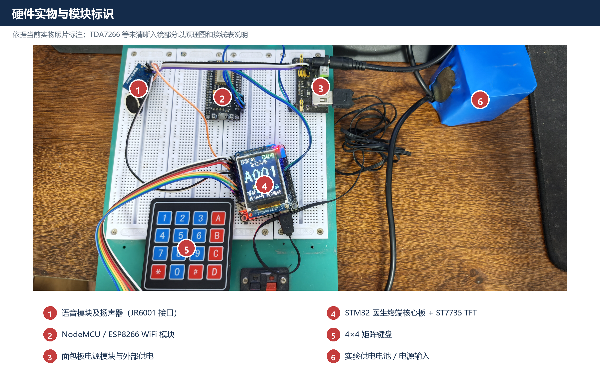

*图 3-2 医生终端实物与模块标识*

实物采用面包板和杜邦线搭建，适合功能验证，但抗干扰、接触可靠性和供电完整性弱于 PCB。论文中可将其表述为“原型验证平台”。正式展示前应重点检查 ESP8266 峰值电流、语音/功放供电、各模块共地和键盘 FPC 方向。

### 3.4 当前有效引脚表

引脚由最新 SCHDOC、网表、`main.h` 和当前驱动交叉核对。自动生成的旧接线清单曾把部分 LQFP64 物理脚号错误翻译成 PD12～PD15 等 GPIO，本文不采用这些错误映射。

| 外设信号 | STM32 引脚 | 软件配置/说明 |
|---|---|---|
| ESP8266 RX | PA2 / USART2_TX | STM32 发往 ESP8266 |
| ESP8266 TX | PA3 / USART2_RX | 中断接收，4096 字节环形缓冲 |
| JR6001 RX | PA9 / USART1_TX | 9600 8N1 ASCII 指令 |
| JR6001 TX | PA10 / USART1_RX | 当前驱动不解析回传 |
| JR6001 BUSY | PC7 | 播放时高、空闲低；带双超时兜底 |
| TFT_SCL | PC8 | 软件 SPI 时钟 |
| TFT_SDA | PC9 | 软件 SPI 数据 |
| TFT_RST | PC10 | 复位 |
| TFT_DC | PB7 | 数据/命令选择 |
| TFT_CS | PB8 | 片选 |
| TFT_BL | PB11 | 背光 |
| 键盘行 1～4 | PB12、PB13、PB14、PB15 | 开漏输出、内部上拉、逐行拉低 |
| 键盘列 1～4 | PB3、PB4、PB5、PB6 | 上拉输入；PB3/PB4 需关闭 JTAG |
| TDA7266 AD1 | PA6 / TIM3_CH1 | 当前 PWM 提示音输出 |
| TDA7266 AD2 | PA7 / TIM3_CH2 | 硬件接口预留 |
| KEY0 | PC5 | 独立按键预留 |
| KEY1 | PA15 | 独立按键预留 |
| WK_UP | PA0 | 独立按键预留 |
| LED0 | PA8 | 受控 LED |
| LED1 | PD2 | 受控 LED |
| SWDIO / SWCLK | PA13 / PA14 | J-Link 下载调试，保留 SWD |

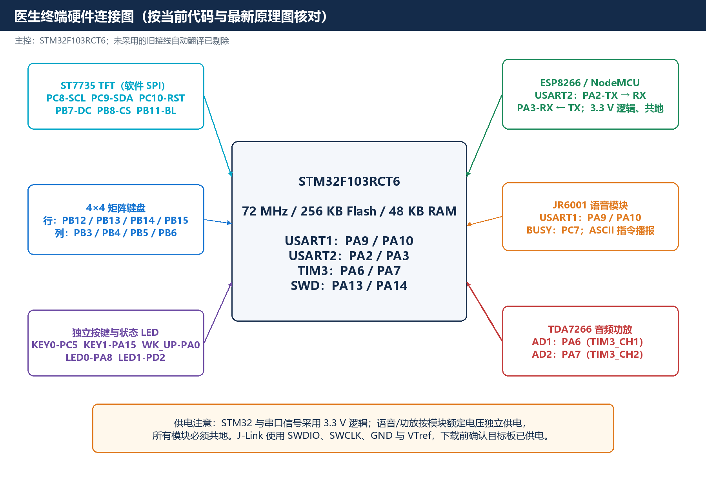

*图 3-3 按当前代码和原理图核对后的硬件连接图*

### 3.5 供电与调试注意事项

- STM32 与串口信号使用 3.3 V 逻辑，不能用 5 V 直接驱动其 UART 输入。
- JR6001 原理图标注 VCC 为 +5 V，驱动注释建议 1 A 级供电；实际接线应遵循所用模块额定参数。
- NodeMCU 可通过 USB 供电，UART 仍使用 3.3 V 逻辑；若使用裸 ESP-01，应使用稳定的 3.3 V 电源并考虑发射峰值电流。
- 语音、功放、ESP8266 与主控必须共地。
- J-Link 的 VTref 用于检测目标电压。若显示 `VTref=0.000V`，应先检查目标板供电和接线，而不是继续烧录或注入 RAM。

## 4 软件体系结构与主程序

### 4.1 软件分层

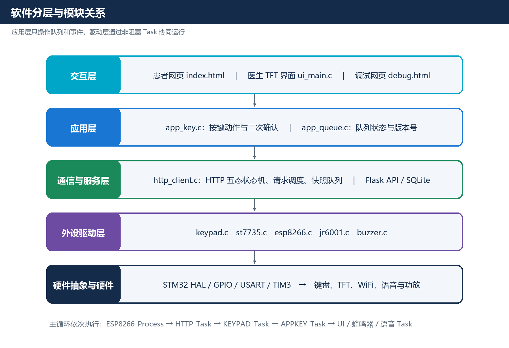

*图 4-1 软件分层与模块关系*

| 层级 | 主要文件 | 职责 |
|---|---|---|
| 交互层 | `index.html`、`debug.html`、`ui_main.c` | 患者操作、医生显示、调试日志展示 |
| 应用层 | `app_key.c`、`app_queue.c` | 按键业务、队列状态转换、确认窗口 |
| 通信与服务层 | `http_client.c`、`server/app.py` | 请求调度、HTTP 报文、API 和数据库 |
| 驱动层 | `keypad.c`、`st7735.c`、`esp8266.c`、`jr6001.c`、`buzzer.c` | 外设访问和非阻塞任务 |
| HAL/硬件层 | `main.c`、`main.h`、STM32 HAL | 时钟、GPIO、USART、TIM3 和中断 |

### 4.2 主程序初始化顺序

`main.c` 先完成 HAL、系统时钟、GPIO、USART1、USART2 和 TIM3 初始化，再依次初始化 ST7735、键盘、本地队列、按键映射、提示音、JR6001、UI、ESP8266 和 HTTP。该顺序保证 UI 初始化时队列、网络状态和语音接口已经可读。

主循环为协作式轮询：

```c
while (1)
{
    ESP8266_Process();
    HTTP_Task();
    KEYPAD_Task();
    APPKEY_Task();
    UIMain_Task();
    BUZZER_Task();
    JR6001_Task();
    HAL_Delay(1U);
}
```

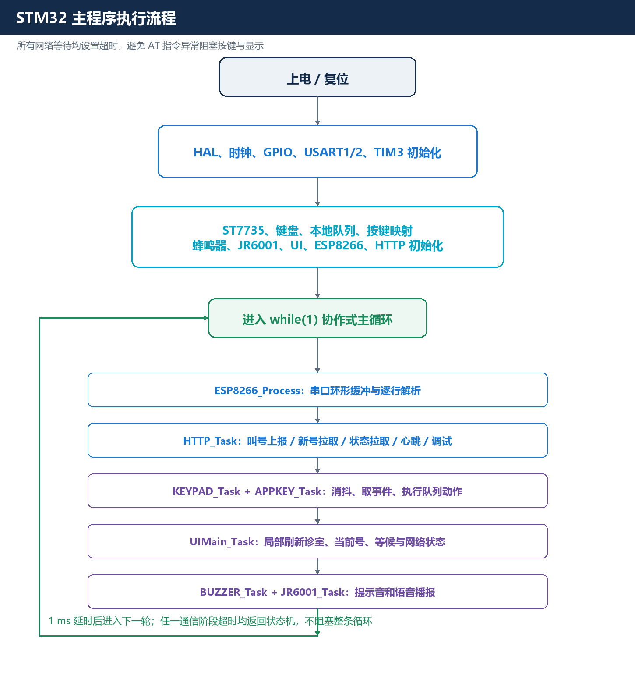

*图 4-2 STM32 主程序执行流程*

该结构不使用 RTOS，逻辑简单、资源占用低，适合毕业设计。其实时性依赖每个 Task 都能快速返回，因此 AT 指令、语音播放和提示音均不能采用无限等待。

### 4.3 当前构建结果

2026-11-16 使用 Keil 已打开工程执行 Rebuild，编译器为 armclang 6.24，结果如下：

| 项目 | 结果 |
|---|---|
| Code | 29372 字节 |
| RO-data | 3592 字节 |
| RW-data | 32 字节 |
| ZI-data | 11336 字节 |
| Errors | 0 |
| Warnings | 0 |
| 产物时间 | 2026-11-16 00:44:43 |
| J-Link 下载 | 2026-11-16 00:45:24 完成编程，`Verify OK` |

命令行调用 `UV4.exe -b` 曾出现返回码为 0 但 AXF/HEX/MAP 时间不变的“假成功”。因此验收时不能只看进程返回码，必须同时检查 Build Output 和产物时间。

## 5 本地队列与按键业务实现

### 5.1 队列数据结构

本地队列定义 `Ticket_t`：

```c
typedef struct
{
    uint8_t       prefix;   /* A～D 等前缀 */
    uint16_t      seq;      /* 1～999 */
    TicketState_t state;    /* WAIT/CALLING/PASSED/DONE */
} Ticket_t;
```

核心状态变量包括：

| 变量 | 含义 |
|---|---|
| `s_tickets[100]` | 号码数组，最大容量 100 |
| `s_count` | 数组中号码总数，包含各种状态 |
| `s_current` | 当前号码在数组中的下标，`0xFFFF` 表示无当前号 |
| `s_paused` | 暂停标志 |
| `s_version` | 队列内容变化计数，用于 UI 刷新和优先上报 |
| `s_announce` | 新叫号播报/闪烁事件标志 |

### 5.2 号码状态机

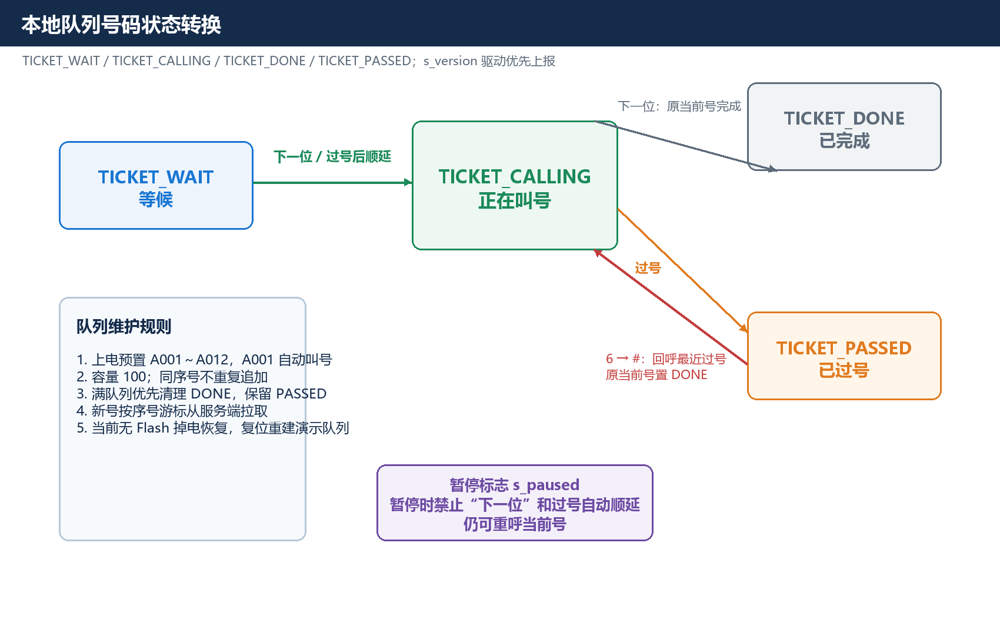

*图 5-1 本地号码状态转换与队列维护规则*

| 操作 | 状态转换 | 暂停时行为 | 是否触发新播报 |
|---|---|---|---|
| 下一位 `QUEUE_Next` | 原 CALLING→DONE；最早 WAIT→CALLING | 不执行 | 成功时触发 |
| 重呼 `QUEUE_Recall` | 状态不变，仅重新设置 announce | 可以重呼 | 有当前号时触发 |
| 过号 `QUEUE_Pass` | 当前 CALLING→PASSED；未暂停则最早 WAIT→CALLING | 过号后不自动顺延 | 有新当前号时触发 |
| 回呼过号 | 最近 PASSED→CALLING；原当前号→DONE | 由按键确认流程决定 | 成功时触发 |
| 暂停/继续 | 只改变 `s_paused` 和版本号 | 状态可切换 | 不直接触发 |

上电初始化写入 A001～A012，A001 自动进入 CALLING。该设计便于离线演示，但也意味着**复位会重建演示队列**，不能将其描述为掉电恢复。

### 5.3 新号追加与容量管理

`QUEUE_Append(prefix, seq)` 按以下顺序处理：

1. 遍历队列，若序号已存在，无论状态如何都拒绝重复追加。
2. 若容量已满，压缩数组并删除所有 DONE 记录。
3. 根据压缩前保存的当前序号重新定位 `s_current`，避免数组移动后当前号指向错误。
4. 保留 PASSED，因为过号仍可能需要回呼。
5. 若清理后仍满，则返回失败；否则在末尾增加 WAIT 号码并递增版本号。

`QUEUE_GetMaxSeq()` 返回队列中最大的序号，终端以它作为 `since` 参数请求新号。该游标机制避免每次拉取全部历史号码，也减少重复追加。

### 5.4 矩阵键盘扫描

键盘每 20 ms 扫描一次。行线采用开漏输出和内部上拉，未选中的行释放为高电平，当前行拉低后读取四根列线。连续两次扫描得到相同键值后才更新稳定键，约形成 40 ms 消抖。

实物 FPC 为反插方向，驱动通过 `KEYPAD_PHYS_INDEX(r,c)` 将扫描索引转换为从左到右、从上到下的物理键位：

```text
1  2  3  A
4  5  6  B
7  8  9  C
*  0  #  D
```

PB3、PB4 默认复用 JTAG 的 JTDO/NJTRST。驱动调用 `__HAL_AFIO_REMAP_SWJ_NOJTAG()` 关闭 JTAG、保留 SWD，因此既能把它们作为键盘列线，也能继续使用 J-Link SWD。

### 5.5 当前按键功能与二次确认

| 按键 | 功能 | 失败/无对象时提示 |
|---|---|---|
| 1 | 下一位 | 200 Hz、300 ms 拒绝音 |
| 2 | 重呼当前号 | 无当前号时拒绝音 |
| 3 | 当前号过号，未暂停时自动顺延 | 无当前号时拒绝音 |
| 4 | 暂停/继续 | 切换后点击音 |
| 6 | 存在过号时进入 3 s 回呼确认窗口 | 无过号时拒绝音 |
| # | 在确认窗口内执行回呼最近过号 | 无过号时拒绝音 |
| * | 取消确认窗口 | 点击音 |
| 其他键 | 当前未分配业务功能 | 拒绝音 |

确认期间忽略其他业务键，3 s 超时自动退出。无论普通分支还是确认分支，每次有效按键事件都会调用 `HTTP_PostDebug()` 留下快照。

### 5.6 TFT、提示音与语音

TFT 分辨率为 128×160：顶栏显示诊室和 WiFi，中间显示当前号，下方显示服务端等候/过号，底栏显示操作提示。队列版本、WiFi、确认状态或服务端统计变化时局部重绘；新叫号时号码黄色闪烁 500 ms。

提示音使用 TIM3_CH1。时钟为 72 MHz、PSC=71，计数频率为 1 MHz，因此目标频率 `f` 对应：

```text
ARR  = 1,000,000 / f - 1
CCR1 = (ARR + 1) / 2
```

播放结束或休止时将比较值清零，避免功放输入保持直流。点击、叫号、确认和拒绝分别使用不同音符序列，`BUZZER_Task()` 按持续时间非阻塞推进。

JR6001 使用 9600 8N1 ASCII 协议，不使用其他语音模块的 `0xAA` 二进制帧。播报 A013 时，软件将“请—A—零—一—三—号—到—一—诊室”映射为 WAV 文件序号并逐段发送 `A7:00001` 等命令。播放状态依次经历发送、等待 BUSY 拉高、等待 BUSY 回低；700 ms 开播超时和片段时长加 900 ms 的兜底防止语音流程卡死。

## 6 ESP8266 与 HTTP 通信实现

### 6.1 UART 接收和 WiFi 状态维护

USART2 使用 115200 波特率和单字节接收中断。中断回调把字节写入 4096 字节环形缓冲，主循环 `ESP8266_Process()` 取出字节并按行组装，行缓冲为 160 字节。超长行被丢弃，避免越界。

WiFi 初始化流程为：

```text
AT → AT+CWMODE=1 → 周期 AT+CWLAP → 找到目标 SSID → AT+CWJAP → WIFI GOT IP
```

扫描间隔为 2 s，扫描超时 10 s，连接超时 20 s，AT 初始化响应超时 1.5 s，失败后按 3 s 间隔重试。已连接目标 WiFi 后停止周期扫描，减少扫描对 TCP 通信的影响。收到 `WIFI DISCONNECT` 后清除连接状态并重新扫描。

### 6.2 HTTP 五态状态机

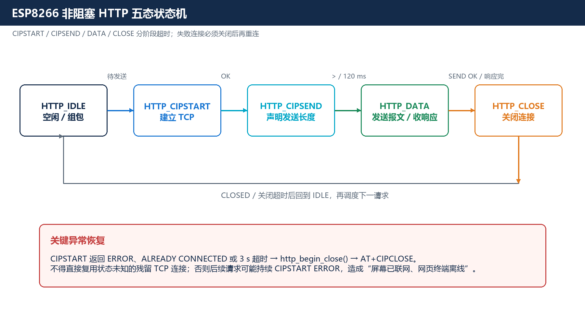

*图 6-1 非阻塞 HTTP 五态状态机与异常恢复*

| 状态 | 主要动作 | 进入下一状态的条件 | 超时/异常 |
|---|---|---|---|
| IDLE | 选择请求、组包、锁存接收属性 | 有业务请求且 WiFi 已连接 | 无请求则保持 |
| CIPSTART | 发送 `AT+CIPSTART="TCP",host,port` | 收到 OK 后发送 CIPSEND | 3 s、ERROR、ALREADY CONNECTED → CLOSE |
| CIPSEND | 发送 `AT+CIPSEND=len` | 固定延时 120 ms 后写 HTTP 报文 | 进入 DATA 后统一兜底 |
| DATA | 等 SEND OK；GET 继续解析响应体 | POST 可关闭；GET 收完或 CLOSED | 3 s 或错误 → CLOSE |
| CLOSE | 发送 `AT+CIPCLOSE` | OK、ERROR、CLOSED 或超时 | 1 s 后回 IDLE |

每次 HTTP 请求使用 `Connection: close`，避免把长连接复用状态混入下一个事务。GET 响应必须解析 header 后的空行，再解析 body。pending 响应末尾增加换行，防止 body 与 `CLOSED` 粘在同一行时漏解析。

### 6.3 请求调度与防止低优先级饥饿

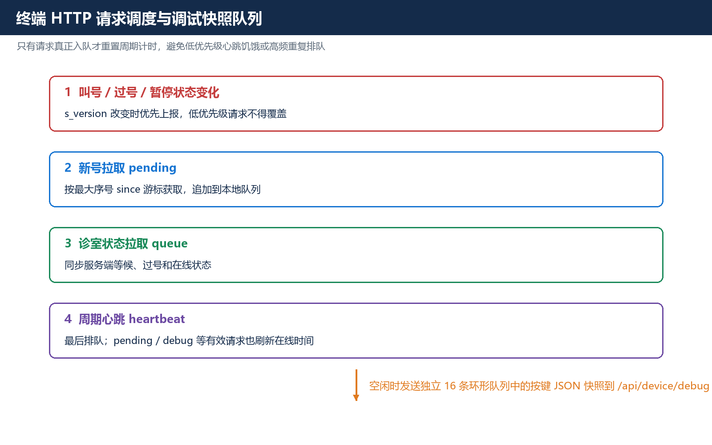

*图 6-2 请求优先级与按键快照队列*

调度顺序如下：

1. 队列版本变化时优先构造 `/api/device/call`，高优先级请求不允许被心跳或拉取覆盖。
2. pending 到期且请求槽空闲时拉取新号。
3. queue 到期且请求槽空闲时拉取诊室状态。
4. 心跳最后排队，不能覆盖已有请求。
5. 无业务请求时才从调试快照环形队列取出一条发送。

关键计时规则是：**只有请求真正入队，才重置对应周期计时**。如果请求槽被占用，到期状态保留到下一轮补排，避免拉取与心跳同周期时拉取被永久跳过。

主要参数如下：

| 参数 | 当前值 |
|---|---|
| 心跳周期 | 5000 ms |
| pending 拉取周期 | 5000 ms |
| queue 拉取周期 | 5000 ms |
| CIPSTART 超时 | 3000 ms |
| DATA 超时 | 3000 ms |
| CLOSE 超时 | 1000 ms |
| CIPSEND 后发送延时 | 120 ms |
| HTTP 请求缓冲 | 320 字节 |
| JSON 缓冲 | 176 字节 |
| 调试快照队列 | 16 条 |

### 6.4 排队属性与接收属性隔离

单请求槽使用 `s_expect_body` 和 `s_pull_type` 表示“待发送请求”的解析方式。请求开始发送后，后续请求可以重新排队；如果响应解析仍读取这两个变量，就会把 pending 响应当成 queue JSON，或把 queue JSON 当成号码列表。

当前实现增加：

```c
static uint8_t s_rx_expect_body;
static uint8_t s_rx_pull_type;

/* 请求开始发送时锁存 */
s_rx_expect_body = s_expect_body;
s_rx_pull_type   = s_pull_type;
```

响应行回调只读取 `s_rx_*`，将“正在接收的请求”与“后续排队的请求”隔离。这是解决网页取号后终端不能及时追加新号的重要修复之一。

### 6.5 TCP 残留连接恢复

故障期间 UART 曾持续出现 `CIPSTART ERROR`。其根因不是 WiFi 未连接，而是 ESP8266 中残留了状态未知的 TCP 连接。旧流程失败后直接回 IDLE，下次继续 CIPSTART，导致每次都可能失败。

当前策略为：

- `ALREADY CONNECTED` 被视为错误，不复用旧连接。
- CIPSTART 出错或超时后调用 `http_begin_close()`。
- 在 CLOSE 状态发送 `AT+CIPCLOSE`，等待响应或 1 s 超时。
- 回到 IDLE 后再调度新的连接。

该修复把一次临时 J-Link 恢复操作固化为永久软件逻辑。修复后 UART 多次观察到正常 `CONNECT` 和 `SEND OK`，服务端持续收到终端请求。

### 6.6 按键调试快照

每次按键生成以下字段：

| 字段 | 含义 |
|---|---|
| `room`、`key` | 诊室和物理键字符 |
| `cur` | 当前本地号码 |
| `wait`、`passed` | 本地 WAIT 和 PASSED 数量 |
| `count` | 本地队列总记录数 |
| `max_seq` | 本地最大序号，也是 pending 游标 |
| `http_state` | 0～4，对应 IDLE/CIPSTART/CIPSEND/DATA/CLOSE |
| `wifi` | ESP8266 无线连接状态 |
| `srv_wait`、`srv_pass`、`srv_online` | 最近一次 queue 拉取得到的服务端状态 |

快照使用独立 16 条环形队列，满时丢弃最旧记录。WiFi 断开时 HTTP 业务状态和待发送请求被复位，但调试快照仍保留，恢复后继续发送。需要注意：`srv_*` 是最近一次拉取值，不是按键瞬间重新查询的数据，可能与服务端当前值存在异步时间差。

## 7 Flask 服务端与数据库实现

### 7.1 服务端结构

服务端由单文件 `app.py`、静态网页和 SQLite 数据库组成。Flask 监听 `0.0.0.0:5000`，允许同网段设备访问。当前使用 Flask 自带开发服务器，适合教学验证，不应直接作为生产部署方式。

| 文件 | 作用 |
|---|---|
| `server/app.py` | 数据表、API、在线判定、静态页面入口 |
| `server/static/index.html` | 患者取号和状态查询 |
| `server/static/debug.html` | 调试快照表格、3 s 自动刷新、日志清空 |
| `server/queue.db` | SQLite 数据库 |
| `server/debug.log` | 每行一个 JSON 的按键快照日志 |

### 7.2 数据表

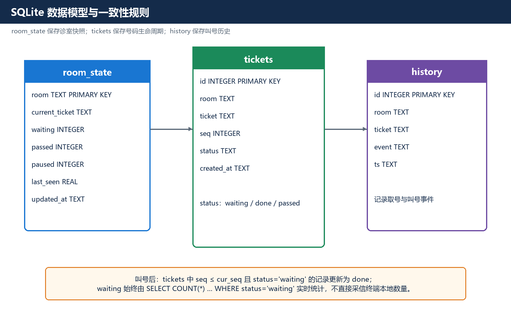

*图 7-1 SQLite 数据模型与一致性规则*

`room_state` 保存诊室当前快照，`current_ticket` 为当前号，`passed` 和 `paused` 主要来自终端上报，`last_seen` 用于在线判定。表中的 `waiting` 是保留字段，当前 `/api/queue` 不采信它，而是实时统计 `tickets`。

`tickets` 保存患者取号记录和号码状态；`history` 保存取号、叫号等事件，字段为 `event` 和 `ts`。

> 当前 `init_db()` 在模块加载时执行，并删除 `tickets`、`history` 和 `room_state` 后重建诊室。因此服务端重启会初始化演示数据，不能把它当成断电不丢数据的生产数据库。

### 7.3 API 一览

| 方法 | 路径 | 主要参数 | 功能与返回 |
|---|---|---|---|
| POST | `/api/ticket` | JSON：`room` | 生成号码，返回 `ticket`、`ahead` |
| GET | `/api/ticket` | `room`、`ticket` | 返回个人号码、当前号、`ahead`、`called` |
| GET | `/api/queue` | `room` | 返回当前号、等候、过号、暂停、在线、更新时间 |
| POST | `/api/device/call` | 当前号、过号、暂停、状态 | 更新诊室和 tickets，写 history |
| POST | `/api/device/heartbeat` | 当前号、暂停等 | 刷新 `last_seen`，更新部分状态 |
| GET | `/api/device/pending` | `room`、`since` | 返回序号大于游标的 waiting 号码，纯文本逗号分隔 |
| POST | `/api/device/debug` | 按键快照 JSON | 追加 `debug.log`，同时刷新在线时间 |
| GET | `/api/device/debug` | `limit`，最大 200 | 倒序返回最近调试快照 |
| POST | `/api/device/debug/clear` | 无 | 删除调试日志文件 |
| GET | `/api/history` | `room`、`limit` | 返回历史事件 |
| GET | `/` | `room` 可由网页读取 | 患者网页 |
| GET | `/debug` | 无 | 调试网页 |

### 7.4 等候人数一致性规则

患者取号时，新记录初始状态为 `waiting`。医生叫号后，服务端执行：

```sql
UPDATE tickets SET status='done'
WHERE room=? AND seq<=? AND status='waiting';
```

查询诊室时实时执行：

```sql
SELECT COUNT(*) FROM tickets
WHERE room=? AND status='waiting';
```

因此等候人数的权威来源是服务端 `tickets` 表，而不是终端本地 WAIT 数量。终端本地队列包含预置号、DONE 和 PASSED，其 `wait` 只用于本地业务与调试，不能直接作为网页等候人数。

过号人数目前仍由终端上报，因为服务端尚未独立维护完整的过号状态机。论文中应明确两种数据的不同来源。

### 7.5 号码分配与个人进度

新序号为：

```text
seq = max(当前叫号序号, tickets 最大序号, 12) + 1
```

因此网页首次取号从 A013 开始，避免与终端预置 A001～A012 冲突。后续已经取到 A030 时，即使终端因复位重新显示 A001，新取号仍可能为 A031，因为 `tickets` 最大序号尚未清除。

个人接口以 `my_seq <= cur_seq` 判断是否已叫过，`ahead` 按序号差估算。它不等于实时 WAIT 记录数；存在过号、跳号或历史记录时，论文中应称其为“按序号估算的前方号码数”。

### 7.6 在线状态判定

`/api/queue` 使用以下规则：

```text
online = (当前 Unix 时间 - room_state.last_seen) <= 60 s
```

60 s 用于容忍 WiFi 扫描和重连。心跳、pending 拉取和 debug 上报都会刷新 `last_seen`，避免“终端持续拉取但只丢心跳就被误判离线”。WiFi 图标只说明无线连接，网页在线说明最近 60 s 内存在有效终端请求，两者应结合 TCP 日志判断。

### 7.7 患者网页与调试网页

患者网页使用浏览器 `localStorage` 按诊室保存个人号码，刷新后仍能查询。页面每 2 s 请求 `/api/queue`；若存在个人号码，同时请求 `/api/ticket`。调试网页每 3 s 请求最近 100 条快照，并用不同颜色显示 HTTP 状态、WiFi 和在线状态。

## 8 构建、烧录与部署

### 8.1 软件环境

| 工具 | 当前使用 | 用途 |
|---|---|---|
| Keil MDK + armclang 6.24 | 已使用 | 固件 Rebuild、AXF/HEX/MAP |
| J-Link Commander V9.74 | 已使用 | SWD 下载、RAM/Flash 读取、事件注入 |
| Python 3 | 已使用 | Flask 服务和测试脚本 |
| Flask | 当前服务端依赖 | HTTP API 和网页 |
| SQLite | Python 内置驱动 | 数据存储 |
| 浏览器 | 当前实测 | 患者端与调试端验收 |

### 8.2 配置检查

1. 在 `http_client.h` 设置 `HTTP_SERVER_HOST`、`HTTP_SERVER_PORT` 和 `HTTP_ROOM`。
2. 在 `esp8266.h` 配置目标 2.4 GHz WiFi。论文公开版应对 SSID 和密码脱敏，不提交真实私密凭据。
3. 检查电脑局域网 IP 是否与配置一致，并确认防火墙允许 TCP 5000。
4. 按第 3 章引脚表检查接线，尤其是 PA2/PA3、PB3～PB6、PB12～PB15 和 TFT_RST=PC10。
5. 确认目标板正常供电后再连接 J-Link，VTref 不应为 0。

### 8.3 启动服务端

在 `server` 目录执行：

```powershell
python app.py
```

正常启动后应看到：

```text
Running on http://127.0.0.1:5000
Running on http://192.168.123.151:5000
```

患者入口为 `http://192.168.123.151:5000/`，调试入口为 `http://192.168.123.151:5000/debug`。服务端每次启动都会初始化演示数据库；若要保留测试数据，应先备份 `queue.db` 和 `debug.log`。

### 8.4 编译与烧录

1. 在 Keil 中打开当前工程，选择 Rebuild。
2. 检查 Build Output 为 0 Error、0 Warning，并核对 AXF/HEX/MAP 修改时间。
3. 连接 J-Link SWDIO、SWCLK、GND、VTref，选择 STM32F103RC 和 SWD。
4. 下载后执行 Flash Verify，再复位运行。
5. 观察 TFT、服务端 `/api/queue` 和 UART 请求，不能只以“Downloaded”判断系统工作正常。

### 8.5 J-Link RAM 调试方法

MAP 文件用于确定静态变量地址。当前已验证固件使用过的脚本读取了队列、ESP、HTTP 状态及 UART 环形缓冲。示例：

```text
device STM32F103RC
si SWD
speed 4000
connect
halt
mem16 0x2000001c, 1
mem8  0x20000084, 0x2c
mem32 0x20002664, 1
savebin C:\Temp\smartcall-esp-rx.bin, 0x2000140c, 0x1000
go
exit
```

`savebin` 的第三个参数是**读取长度**，不是结束地址。上述地址只适用于对应 MAP 版本，重新编译后必须重新解析，不能直接照搬到新固件。

当前固件曾通过向键盘事件变量写入键索引 0 来模拟物理键“1”：

```text
halt
w1 0x20000006, 0x00
go
```

注入后应立即读取服务端日志验证，而不是把脚本返回成功当成按键已执行。批量注入与网页瞬时号码可能因异步上报、继续运行和读取时刻不同而存在时间差，不能简单以“注入次数”推算页面增量。

## 9 实测步骤与结果

### 9.1 测试证据分级

- **A 类：已执行并留有结果。** 包括编译、下载、pending、新号跨边界叫号、网页取号和在线状态。
- **B 类：代码已实现，建议按本文步骤补做论文验收。** 包括过号、回呼、暂停和断网恢复的完整截图链。
- **C 类：后续功能。** 双热备、小程序、掉电恢复和生产部署不属于本次测试。

### 9.2 已完成的固件验证

| 时间 | 操作 | 观察结果 | 结论 |
|---|---|---|---|
| 00:44:43 | Keil Rebuild | Code=29372，0 Error、0 Warning | 构建通过 |
| 00:45:24 | J-Link 擦除、编程、校验 | `Verify OK` | 烧录完整性通过 |
| 复位后 | 读取队列和 HTTP RAM | 队列由 12 条增长到 14 条 | 新号已进入本地队列 |
| 复位后 | 请求 `pending?room=01&since=12` | 返回 `A013,A014` | 游标接口正确 |
| 复位后 | 抓取 UART 环形缓冲 | 多次 `CONNECT`、`SEND OK` | TCP 事务恢复 |
| 00:51:49～00:51:59 | J-Link 注入下一位并读取日志 | A012→A013→A014，等候 2→1→0 | 越过预置边界叫号通过 |
| 后续观察 | 查询 `/api/queue` | current=A014、waiting=0、online=true | 服务端状态一致 |
| 持续观察 | 多次查询在线状态 | 保持 online=true | 未再出现持续 CIPSTART ERROR |

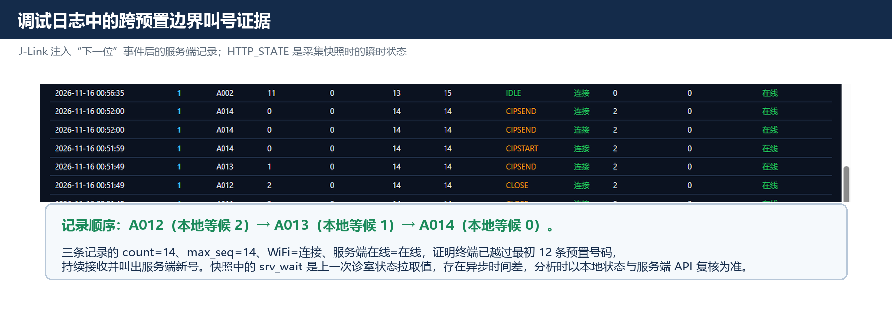

*图 9-1 调试日志中 A012→A013→A014 的实测证据*

图中 HTTP 状态是按下按键时的瞬时值，不代表请求失败。例如 CLOSE、CIPSTART、CIPSEND 都是正常状态机阶段。判断通信是否成功，应结合后续 `CONNECT`、`SEND OK`、服务端当前号和在线状态，而不是要求所有快照都为 IDLE。

### 9.3 患者网页实测

测试步骤：

1. 打开患者网页，记录取号前当前号、等候人数和在线状态。
2. 点击“我要取号”，记录返回的个人号码和前方人数。
3. 等待页面下一次 2 s 自动刷新，记录等候人数。
4. 对照 `/api/queue` 和 `/api/ticket` 返回。

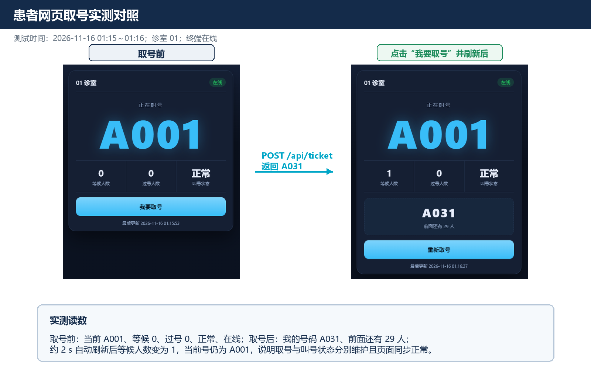

*图 9-2 患者网页取号前后对照*

| 测量项 | 取号前 | 取号并刷新后 |
|---|---|---|
| 当前叫号 | A001 | A001 |
| 等候人数 | 0 | 1 |
| 过号人数 | 0 | 0 |
| 叫号状态 | 正常 | 正常 |
| 终端状态 | 在线 | 在线 |
| 个人号码 | 无 | A031 |
| 个人前方号码数 | — | 29 |

A031 与 A001 同时出现并不矛盾：终端此前复位使当前号回到 A001，而服务端已有 A030 及之前的取号记录，新号按 tickets 最大序号继续递增。该现象也再次说明“当前叫号进度”和“新号发放进度”是两个不同概念。

### 9.4 调试网页实测

调试页实测显示 44 条记录，包含按键、当前号、本地等候、本地过号、队列数、最大序号、HTTP 状态、WiFi、服务端统计和在线状态。页面能够同时展示正常 IDLE 与 CIPSTART/CIPSEND 等瞬时状态，便于判断按键后终端究竟处于哪个阶段。

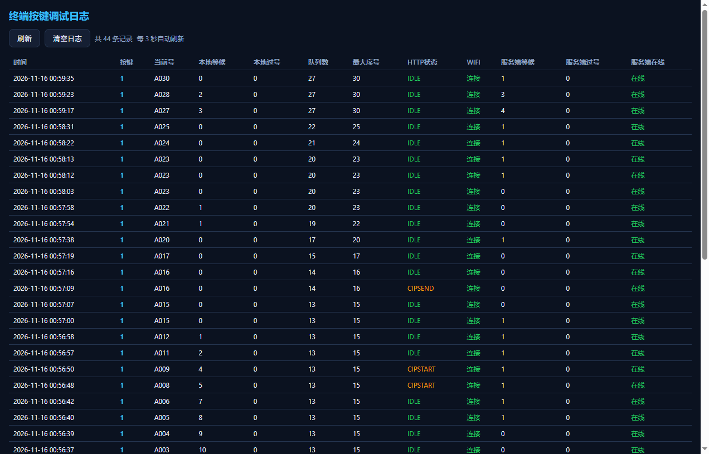

*图 9-3 调试网页实测总览*

### 9.5 建议补做的业务验收用例

以下功能已经由当前代码实现，但论文定稿前建议逐项补拍终端和网页对照图。

| 用例 | 操作步骤 | 预期结果 | 需要保存的证据 |
|---|---|---|---|
| 下一位 | 有等候号时按 1 | 原当前号 DONE，最早 WAIT 成为当前号 | TFT、queue API、debug 快照 |
| 重呼 | 按 2 | 当前号不变，重新闪烁并播报 | TFT 照片/视频、语音记录 |
| 过号 | 按 3 | 当前号进入 PASSED，未暂停则自动顺延 | passed 增加、当前号变化 |
| 回呼 | 先过号，再按 6、# | 最近 PASSED 成为当前号 | passed 减少、历史与快照 |
| 取消回呼 | 按 6 后按 * 或等待 3 s | 不执行回呼，退出确认 | 底栏提示和队列不变 |
| 暂停 | 按 4 后按 1 | 暂停状态上报，下一位被拒绝 | 网页“暂停”、拒绝音 |
| 继续 | 再按 4 后按 1 | 恢复下一位 | 网页“正常”、当前号变化 |
| 队列去重 | 连续拉取同一 since | 同序号不重复追加 | count 不异常增长 |
| 断网本地操作 | 断开 WiFi 后按 1/2/3 | 本地队列和显示仍可操作 | 屏幕未联网、本地号码变化 |
| 网络恢复 | 恢复 WiFi | 自动重连并继续状态拉取/心跳 | online 恢复、UART 正常 |
| 满队列 | 构造 100 条后追加 | 优先清理 DONE，PASSED 保留 | RAM 数组和 current 下标 |
| 服务端重启 | 备份后重启 app.py | 三张表重新初始化 | 作为当前限制验证，不当作持久化通过 |

### 9.6 当前 J-Link 补充连接记录

在整理本说明书素材时再次尝试注入“下一位”，J-Link 返回通信超时、`VTref=0.000V`，随后未建立 SWD 连接。因此本次没有新增硬件注入结果，文档只引用此前已经完成的下载、RAM/UART 和日志证据。复现时应先恢复目标供电，再执行第 8 章步骤。

## 10 典型故障分析与修复总结

| 故障现象 | 根因 | 修复方法 | 验证结果 |
|---|---|---|---|
| 网页新取 A020～A023，终端停在 A012 | 队列容量和 DONE 记录占用、请求调度与响应解析问题 | 容量扩到 100；满时清理 DONE；pending 优先；游标追加去重 | A013、A014 入队并继续叫号 |
| pending/queue 响应偶尔解析错误 | 后续排队请求覆盖正在接收请求的 `s_expect_body/s_pull_type` | 增加 `s_rx_expect_body/s_rx_pull_type`，发送时锁存 | 两类 GET 响应按各自类型解析 |
| 网页等候人数与终端不一致 | 采信终端本地 WAIT 数，数据源不统一 | 网页 waiting 改为实时统计 tickets.status='waiting' | A031 取号后网页 waiting=1 |
| 屏幕已联网、网页终端离线 | WiFi 状态与 TCP 事务混同；只依赖心跳刷新在线；残留 TCP 连接 | pending/debug 也刷新在线；失败统一 CIPCLOSE | online=true，UART 恢复 CONNECT/SEND OK |
| CIPSTART 持续 ERROR | 失败后直接重连，未清理旧 TCP | ALREADY CONNECTED 视为错误；CIPSTART 失败/超时进入 CLOSE | 未再出现永久性 CIPSTART 错误 |
| 按 1 偶发无响应或需连续按 | 业务请求被心跳/拉取挤占，调试证据不足 | 叫号事件最高优先级；只有入队才重置计时；增加按键快照 | 日志可追踪每次按键和队列变化 |
| Keil 命令行看似成功但未更新 | 返回码不能代表真实 Rebuild | 使用 Keil GUI Rebuild，核对日志和产物时间 | 0 Error、0 Warning |
| J-Link 首次读取异常 | 复位运行不完整；savebin 参数误用 | 独立 reset/go；第三参数改长度 0x1000 | 读到正常队列和 UART 缓冲 |
| 把旧 online=true 当成新固件结果 | 未核对 updated_at 和请求时间 | 联合检查时间戳、RAM、UART 和新日志 | 避免缓存状态误判 |

这些故障说明，嵌入式联网系统不能仅从单一界面推断状态。较可靠的定位链为：

```text
按键事件 → 本地队列 RAM → HTTP 状态机 → ESP UART 原始行
→ Flask 请求日志 → SQLite/API → 患者与调试网页
```

## 11 当前限制与后续改进

### 11.1 可靠性与数据持久化

1. 终端队列仅保存在 RAM，复位后重建 A001～A012。后续可在 Flash 中保存当前号、最大序号、队列状态和校验码，并设计掉电写入磨损均衡。
2. 服务端启动会清空业务表。后续应删除演示清表逻辑，使用显式初始化命令和数据库迁移。
3. 当前为单 Flask 节点。若继续实现双热备，需要解决数据库复制、主备仲裁、脑裂防护、终端切换和重复请求幂等，而不是简单增加第二个 IP。
4. 离线期间业务请求槽会复位，不保证完整历史批量补传。后续可增加带序号的操作日志和服务端幂等确认。

### 11.2 协议与安全性

- 当前 HTTP 为局域网明文短连接，没有 TLS、鉴权和签名，调试清空接口也没有权限控制。
- WiFi 凭据直接编译在固件中，公开论文和代码仓库应脱敏，并使用独立配置或安全配网。
- 轻量字符串 JSON 解析适合字段固定的教学项目；若协议扩展，建议使用小型 JSON 解析器和明确长度校验。
- Flask 开发服务器不适合生产，应改用正式 WSGI 服务、反向代理、访问控制和日志轮转。

### 11.3 业务一致性

- `passed` 仍主要依赖终端上报，服务端没有独立完整过号状态机。
- `ahead` 按序号差估算，不严格等于等候记录数量。
- 服务端叫号规则会把序号不大于当前号的 waiting 记录统一置 done，复杂过号和回呼场景需要更细粒度状态同步。
- 当前 TFT 的等候/过号以最近一次服务端拉取为准，存在最长约一个拉取周期加网络耗时的显示延迟。

### 11.4 原型硬件

面包板原型适合验证，不宜直接用于长期公共场所运行。后续应制作 PCB，完善电源去耦、ESD、防反接、音频地与数字地布局、键盘连接器和外壳，并进行长时间老化测试。

## 12 毕业论文组织建议

### 12.1 推荐章节结构

| 论文章节 | 可采用的本文内容 |
|---|---|
| 绪论 | 第 1～2 章：背景、需求、目标和功能边界 |
| 系统总体方案 | 图 2-1、图 2-2：网络拓扑、数据流和模块划分 |
| 硬件设计 | 第 3 章：最新原理图、实物图、引脚和供电 |
| 终端软件设计 | 第 4～6 章：主循环、队列、键盘、显示、语音、HTTP |
| 服务端与网页设计 | 第 7 章：Flask、SQLite、API 和一致性规则 |
| 系统调试与测试 | 第 8～10 章：构建、J-Link、实测证据和故障分析 |
| 总结与展望 | 第 11 章：限制、持久化、可靠性和安全改进 |

### 12.2 可作为论文技术重点的内容

1. **离线保底与在线同步协同。** 本地队列保证基本操作，服务端 tickets 保证网页统计一致性。
2. **非阻塞短连接 HTTP 状态机。** 在资源受限 MCU 上实现连接、发送、接收和关闭的分阶段超时。
3. **请求优先级和接收属性隔离。** 解决高优先级叫号事件、周期拉取和心跳之间的竞争。
4. **TCP 残留连接自恢复。** 将 WiFi 状态与 HTTP 事务状态分离，通过 CIPCLOSE 清理异常连接。
5. **可观测性设计。** 每次按键生成状态快照，结合 J-Link RAM、UART 和 Flask 日志形成证据链。
6. **面向原型的实测方法。** 使用 A012→A013→A014 跨预置边界测试验证新号同步，而不是只测试初始号码。

### 12.3 测试结果写作注意事项

- 不把“代码存在”写成“实测通过”，应附操作步骤、输入、预期和实际结果。
- 不以单次 online=true 推断长期稳定，应记录更新时间和连续观察过程。
- 不把 HTTP 中间状态当成错误；必须结合最终响应和服务端变化。
- 不将 J-Link 注入次数直接等同于页面叫号次数，异步系统需要按日志序号核对。
- 不将旧规划中的双热备、小程序和 Flash 恢复写入本次成果。
- 图片注明来源和日期，实测截图保留关键读数，示意图注明“依据当前实现绘制”。

## 附录 A 常用 API 验证示例

查询诊室：

```http
GET http://192.168.123.151:5000/api/queue?room=01
```

典型返回：

```json
{
  "room": "01",
  "current": "A014",
  "waiting": 0,
  "passed": 0,
  "paused": false,
  "online": true,
  "updated_at": "2026-11-16 00:52:00"
}
```

查询 A012 之后的新号：

```http
GET http://192.168.123.151:5000/api/device/pending?room=01&since=12
```

返回：

```text
A013,A014
```

患者取号：

```http
POST /api/ticket
Content-Type: application/json

{"room":"01"}
```

调试快照示例：

```json
{
  "room": "01",
  "key": "1",
  "cur": "A013",
  "wait": 1,
  "passed": 0,
  "count": 14,
  "max_seq": 14,
  "http_state": 2,
  "wifi": 1,
  "srv_wait": 2,
  "srv_pass": 0,
  "srv_online": 1
}
```

## 附录 B 关键源码索引

| 内容 | 文件 |
|---|---|
| 初始化与主循环 | `SmartCallSystem/Core/Src/main.c` |
| 当前引脚宏 | `SmartCallSystem/Core/Inc/main.h` |
| 队列实现 | `SmartCallSystem/Core/Src/app_queue.c` |
| 按键业务与二次确认 | `SmartCallSystem/Core/Src/app_key.c` |
| 矩阵键盘 | `SmartCallSystem/Core/Src/keypad.c` |
| TFT 主界面 | `SmartCallSystem/Core/Src/ui_main.c` |
| ST7735 驱动 | `SmartCallSystem/Core/Src/st7735.c` |
| ESP8266 驱动 | `SmartCallSystem/Core/Src/esp8266.c` |
| HTTP 状态机 | `SmartCallSystem/Core/Src/http_client.c` |
| 服务端地址和诊室 | `SmartCallSystem/Core/Inc/http_client.h` |
| PWM 提示音 | `SmartCallSystem/Core/Src/buzzer.c` |
| JR6001 语音 | `SmartCallSystem/Core/Src/jr6001.c` |
| Flask 与 SQLite | `server/app.py` |
| 患者网页 | `server/static/index.html` |
| 调试网页 | `server/static/debug.html` |
| 最新原理图 | `原理图/Sheet_1_2026-11-16.schdoc` |
| 最新网表 | `原理图/Sheet_1_2026-11-11.net` |
| 实物照片 | `实物图/硬件实物图.jpg` |

## 附录 C 答辩前检查清单

| 检查项 | 通过标准 |
|---|---|
| 服务端 | 电脑 IP 正确，5000 可访问，启动后无异常 |
| 数据备份 | 已备份需要保留的 queue.db 和 debug.log |
| 终端供电 | 电源稳定，各模块共地，J-Link VTref 正常 |
| WiFi | 2.4 GHz 可用，终端、手机和电脑同网段 |
| 固件 | 最新 Rebuild，0 Error、0 Warning，下载 Verify OK |
| 键盘 | 1/2/3/4/6/#/* 与物理丝印一致 |
| TFT | 诊室、当前号、WiFi、等候和过号显示正常 |
| 语音 | 号码顺序正确，无长时间卡死，音量适中 |
| 取号同步 | 新号进入 pending，终端 max_seq 增长，网页 waiting 正确 |
| 跨边界叫号 | 能从 A012 继续叫到 A013 及以后 |
| 在线状态 | 终端请求持续，网页不频繁误报离线 |
| 异常恢复 | 断开并恢复 WiFi 后能继续通信 |
| 演示边界 | 明确单服务、网页端、RAM 队列和启动清表现状 |
